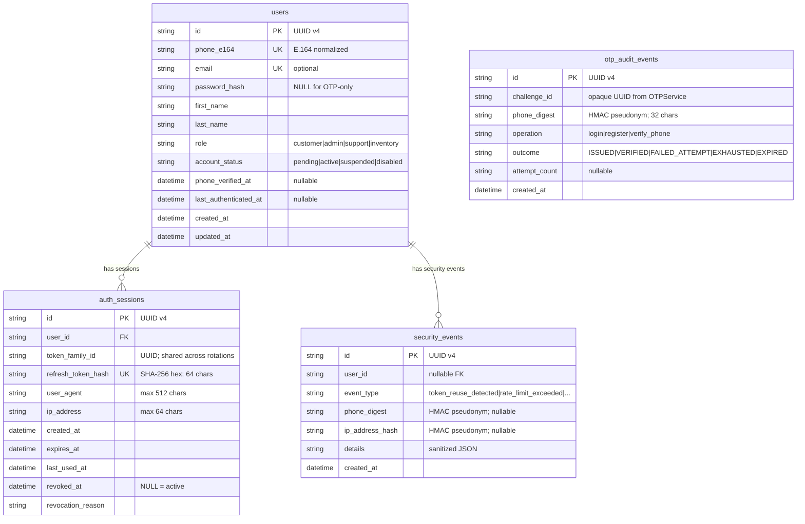

# Database Design (DATABASE.md)
## Jai Bhavani Pearls & Beads — Secure OTP Authentication System

> **Version:** 1.0 | **Date:** 2026-10-30  
> **Engine:** PostgreSQL 16 (production) / SQLite 3.45 (development/testing)

---

## 1. Design Principles

| Principle | Implementation |
|-----------|---------------|
| **UUID primary keys** | All tables use `String(36)` UUID v4 PK; avoids sequential ID enumeration |
| **Timezone-aware timestamps** | All `DateTime` columns use `timezone=True`; stored/compared as UTC |
| **No plaintext OTPs** | OTPs are never persisted in any table, ever |
| **No plaintext refresh tokens** | `auth_sessions.refresh_token_hash` is `SHA-256(raw_token)` only |
| **Phone PII protection** | `users.phone_e164` in plaintext for authoritative storage only; all logs/Redis use keyed HMAC pseudonyms |
| **Soft deletion for sessions** | Sessions are revoked via `revoked_at` timestamp, not deleted, enabling audit trails |
| **Cascade deletes** | `auth_sessions` and audit events cascade on `users` deletion |
| **Index strategy** | Selective indexes on lookup columns; composite index on `(token_family_id, revoked_at)` for family revocation queries |

---

## 2. Table Definitions

### 2.1 `users`

Authoritative user identity store. One record per E.164 phone number.

```sql
CREATE TABLE users (
    id                   VARCHAR(36)   PRIMARY KEY DEFAULT gen_random_uuid()::text,
    phone_e164           VARCHAR(32)   NOT NULL UNIQUE,          -- E.164 canonical, e.g. +919876543210
    email                VARCHAR(255)  UNIQUE,                   -- Optional; not used for primary auth
    password_hash        VARCHAR(255),                           -- Reserved for future hybrid auth; NULL for pure OTP
    first_name           VARCHAR(100)  DEFAULT 'Valued',
    last_name            VARCHAR(100)  DEFAULT 'Customer',
    role                 VARCHAR(32)   NOT NULL DEFAULT 'customer', -- customer | admin | support | inventory
    account_status       VARCHAR(32)   NOT NULL DEFAULT 'active',   -- pending | active | suspended | disabled
    phone_verified_at    TIMESTAMPTZ,                            -- Set on first successful OTP verification
    last_authenticated_at TIMESTAMPTZ,                          -- Updated on every successful login
    created_at           TIMESTAMPTZ   NOT NULL DEFAULT now(),
    updated_at           TIMESTAMPTZ   NOT NULL DEFAULT now()
);

CREATE INDEX ix_users_phone_e164 ON users(phone_e164);
CREATE INDEX ix_users_email ON users(email) WHERE email IS NOT NULL;
CREATE INDEX ix_users_role ON users(role);
CREATE INDEX ix_users_account_status ON users(account_status);
```

**Column Semantics:**
| Column | Notes |
|--------|-------|
| `id` | UUID v4; never sequential |
| `phone_e164` | Canonical format enforced by `PhoneNumberService`; unique constraint prevents duplicates |
| `role` | Application-level RBAC; checked in `RequireAdmin` route guard |
| `account_status` | `pending` (registered, not yet verified), `active` (verified), `suspended` (admin action), `disabled` (self-deleted equivalent) |
| `phone_verified_at` | Null until first OTP verification succeeds |
| `password_hash` | `NULL` for OTP-only accounts; reserved for future hybrid auth (bcrypt) |

---

### 2.2 `auth_sessions`

One row per issued refresh token. Supports token family tracking and reuse detection.

```sql
CREATE TABLE auth_sessions (
    id                   VARCHAR(36)   PRIMARY KEY DEFAULT gen_random_uuid()::text,
    user_id              VARCHAR(36)   NOT NULL REFERENCES users(id) ON DELETE CASCADE,
    token_family_id      VARCHAR(36)   NOT NULL,                    -- UUID; all rotations share same family
    refresh_token_hash   VARCHAR(64)   NOT NULL UNIQUE,             -- SHA-256 hex of raw opaque token
    user_agent           VARCHAR(512),                              -- Truncated to 512 chars
    ip_address           VARCHAR(64),                               -- Stored as received (not hashed; see note)
    created_at           TIMESTAMPTZ   NOT NULL DEFAULT now(),
    expires_at           TIMESTAMPTZ   NOT NULL,                    -- now() + REFRESH_TOKEN_TTL_SECONDS
    last_used_at         TIMESTAMPTZ   NOT NULL DEFAULT now(),
    revoked_at           TIMESTAMPTZ,                               -- NULL = active; NOT NULL = revoked
    revocation_reason    VARCHAR(128)  -- logout | rotated | token_reuse_detected | logout_all | expired
);

CREATE INDEX ix_auth_sessions_user_id       ON auth_sessions(user_id);
CREATE INDEX ix_auth_sessions_family_id     ON auth_sessions(token_family_id);
CREATE INDEX ix_auth_sessions_expires_at    ON auth_sessions(expires_at);
CREATE INDEX ix_auth_sessions_revoked_at    ON auth_sessions(revoked_at);
CREATE INDEX ix_session_family_revoked      ON auth_sessions(token_family_id, revoked_at);
-- refresh_token_hash has UNIQUE constraint which implies an index
```

**Token Family Logic:**
- When a user first authenticates, a new `token_family_id` (UUID) is generated.
- Every `rotate_refresh_token` call: old session gets `revoked_at=now, reason=rotated`; new session is inserted with the **same** `token_family_id`.
- If a **revoked** refresh token is presented: all sessions with the same `token_family_id` are revoked immediately (including the currently active one).

**Note on `ip_address`:** Stored for audit/support purposes only; not used for authentication decisions. Consider hashing in high-privacy environments.

---

### 2.3 `otp_audit_events`

Append-only privacy-compliant audit log for all OTP operations.

```sql
CREATE TABLE otp_audit_events (
    id             VARCHAR(36)  PRIMARY KEY DEFAULT gen_random_uuid()::text,
    challenge_id   VARCHAR(64)  NOT NULL,          -- Opaque challenge UUID from OTPService
    phone_digest   VARCHAR(64)  NOT NULL,          -- HMAC-SHA256(server_key, phone_e164)[:32]; NEVER plaintext
    operation      VARCHAR(32)  NOT NULL,          -- login | register | verify_phone
    outcome        VARCHAR(32)  NOT NULL,          -- ISSUED | VERIFIED | FAILED_ATTEMPT | EXHAUSTED | EXPIRED | REJECTED
    attempt_count  VARCHAR(8),                     -- Number of attempts at time of event (for FAILED/EXHAUSTED)
    created_at     TIMESTAMPTZ  NOT NULL DEFAULT now()
);

CREATE INDEX ix_otp_audit_challenge    ON otp_audit_events(challenge_id);
CREATE INDEX ix_otp_audit_phone_digest ON otp_audit_events(phone_digest);
CREATE INDEX ix_otp_audit_created_at  ON otp_audit_events(created_at);
CREATE INDEX ix_otp_audit_outcome     ON otp_audit_events(outcome);
```

**Outcome Values:**
| Value | Trigger |
|-------|---------|
| `ISSUED` | OTP challenge successfully created and SMS dispatched |
| `VERIFIED` | OTP verified correctly; session created |
| `FAILED_ATTEMPT` | Incorrect OTP submitted; attempts remaining |
| `EXHAUSTED` | Max attempts reached; challenge invalidated |
| `EXPIRED` | Challenge not found (TTL elapsed) |
| `REJECTED` | Rate limit or cooldown blocked the request |

**Retention Policy:** Retain 90 days. A scheduled `DELETE FROM otp_audit_events WHERE created_at < now() - INTERVAL '90 days'` job should be configured.

---

### 2.4 `security_events`

Security-relevant events requiring investigation or compliance reporting.

```sql
CREATE TABLE security_events (
    id               VARCHAR(36)  PRIMARY KEY DEFAULT gen_random_uuid()::text,
    user_id          VARCHAR(36),                  -- NULL if user not yet known (e.g., pre-auth event)
    event_type       VARCHAR(64)  NOT NULL,        -- token_reuse_detected | account_suspended | admin_action | suspicious_login
    phone_digest     VARCHAR(64),                  -- HMAC pseudonym; NULL if not applicable
    ip_address_hash  VARCHAR(64),                  -- HMAC pseudonym of IP; NULL if not applicable
    details          TEXT,                         -- JSON-encoded sanitized metadata; NO OTPs/tokens/HMACs
    created_at       TIMESTAMPTZ  NOT NULL DEFAULT now()
);

CREATE INDEX ix_security_events_user_id    ON security_events(user_id);
CREATE INDEX ix_security_events_event_type ON security_events(event_type);
CREATE INDEX ix_security_events_created_at ON security_events(created_at);
```

**Event Types:**
| Type | Description |
|------|-------------|
| `token_reuse_detected` | Revoked refresh token presented; entire family revoked |
| `otp_exhausted` | User exhausted max OTP attempts for a challenge |
| `account_suspended` | Admin suspended an account |
| `rate_limit_exceeded` | IP or phone rate limit triggered |
| `admin_action` | Admin modified user data |

---

## 3. Entity-Relationship Diagram



---

## 4. Redis Key Hierarchy

Redis stores only **ephemeral** state. All keys have TTLs. No OTPs in plaintext.

| Key Pattern | Data Type | TTL | Purpose |
|-------------|-----------|-----|---------|
| `otp:challenge:{challenge_id}` | Hash | 300 s | OTP challenge state: `{key_version, mac, purpose, phone_digest, attempts, status, created_at}` |
| `otp:phone_cooldown:{phone_digest}` | String | 60 s | Presence flag — blocks resend within cooldown window |
| `otp:phone_rate:{phone_digest}` | Sorted Set | 900 s + 10 s | Sliding window timestamps for per-phone rate limit (3 per 15 min) |
| `otp:ip_rate:{ip_digest}` | Sorted Set | 900 s + 10 s | Sliding window timestamps for per-IP rate limit (10 per 15 min) |
| `otp:daily_rate:{phone_digest}` | Integer (INCR) | 86400 s | Daily OTP request counter per phone (max 10/day) |
| `auth:revoked_jti:{jti}` | String | Access token TTL | Fast-path access token revocation (reserved for future use) |

**Key Design Notes:**
- `{phone_digest}` = `HMAC-SHA256(server_key, phone_e164)[:32]` — 32-char hex pseudonym
- `{ip_digest}` = `HMAC-SHA256(server_key, client_ip)[:32]` — same function
- `{challenge_id}` = UUID v4 string — opaque identifier

---

## 5. Migration Strategy

### 5.1 Tooling

Alembic manages all schema changes. Configuration lives in `backend/alembic.ini` and `backend/alembic/env.py`.

```
backend/
  alembic.ini
  alembic/
    env.py
    versions/
      001_auth_tables.py      ← Initial schema
      002_add_indexes.py      ← (future) Additional indexes
      003_add_otp_ip.py       ← (future) OTP issuer IP tracking
```

### 5.2 Migration Commands

```bash
# Apply all pending migrations (production-safe)
alembic upgrade head

# Rollback last migration
alembic downgrade -1

# Generate new auto-migration from model changes
alembic revision --autogenerate -m "description_of_change"

# Check current revision
alembic current

# Show history
alembic history --verbose
```

### 5.3 Production Migration Checklist

> [!IMPORTANT]
> Before running migrations in production:
> 1. Take a full PostgreSQL backup (`pg_dump`)
> 2. Test migration on a staging database first
> 3. Run `alembic upgrade head` during low-traffic window
> 4. Verify application health endpoints after migration
> 5. Keep `downgrade()` function in every migration file

### 5.4 Development vs Production Schema

| Concern | Development | Production |
|---------|-------------|------------|
| Schema creation | `Base.metadata.create_all()` in `app/main.py` (SQLite) | Alembic `upgrade head` only |
| Column types | SQLite-compatible (`String`, `DateTime`) | PostgreSQL native types via Alembic |
| UUID generation | Application-side `uuid.uuid4()` | `gen_random_uuid()` or application-side |
| Timezone | UTC enforced in application | `TIMESTAMPTZ` (PostgreSQL enforces) |

---

## 6. Backup and Recovery

### Backup Procedure

```bash
# Full database dump (compressed)
pg_dump \
  --host=localhost \
  --port=5432 \
  --username=auth_user \
  --dbname=auth_db \
  --format=custom \
  --compress=9 \
  --file=auth_db_$(date +%Y%m%d_%H%M%S).dump

# Upload to S3 (production)
aws s3 cp auth_db_*.dump s3://your-backup-bucket/postgres/ --sse aws:kms
```

### Restore Procedure

```bash
# Restore from dump
pg_restore \
  --host=localhost \
  --port=5432 \
  --username=auth_user \
  --dbname=auth_db \
  --clean \
  --if-exists \
  auth_db_YYYYMMDD_HHMMSS.dump
```

### Recovery Point Objective (RPO)

| Backup Type | Frequency | Retention |
|------------|-----------|-----------|
| Full dump | Daily (3:00 AM UTC) | 30 days |
| WAL archiving | Continuous (if configured) | 7 days |
| Redis AOF | On write (appendonly yes) | Persisted in Docker volume |

---

## 7. Data Retention and Privacy

| Data Category | Storage | Retention | Deletion |
|--------------|---------|-----------|---------|
| User identity (`users`) | PostgreSQL | Active account lifetime | On account deletion request (GDPR right to erasure) |
| Sessions (`auth_sessions`) | PostgreSQL | 14 days (REFRESH_TOKEN_TTL) | Purge expired+revoked sessions older than 90 days |
| OTP audit events | PostgreSQL | 90 days | Scheduled DELETE job |
| Security events | PostgreSQL | 1 year (compliance) | Scheduled DELETE job |
| OTP challenges | Redis | 5 minutes (TTL auto-expire) | Automatic |
| Rate limit counters | Redis | 15 minutes to 24 hours (TTL) | Automatic |

**PII Controls:**
- `users.phone_e164` — the only location where a phone number is stored in canonical form
- All other references use `HMAC(server_key, phone_e164)[:32]` pseudonyms
- On GDPR erasure: set `phone_e164` to a hash placeholder; set `account_status=disabled`; purge associated sessions

