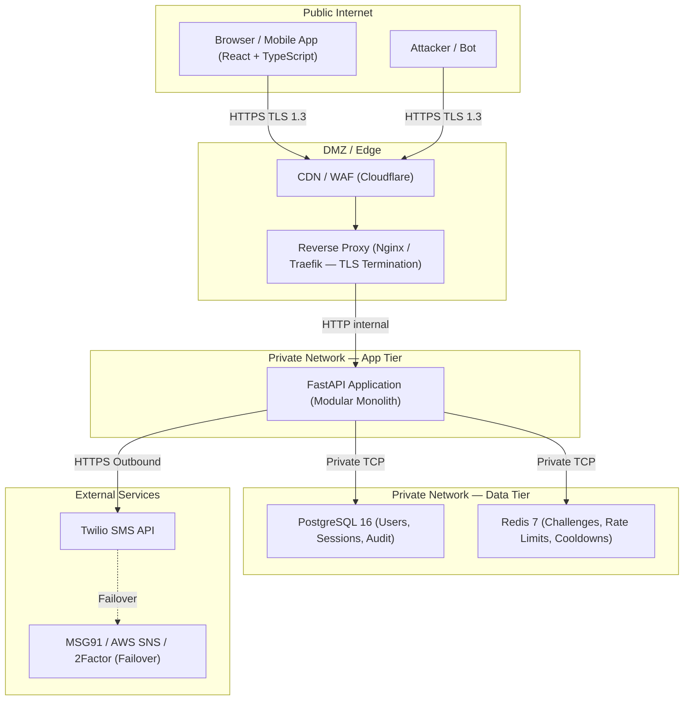
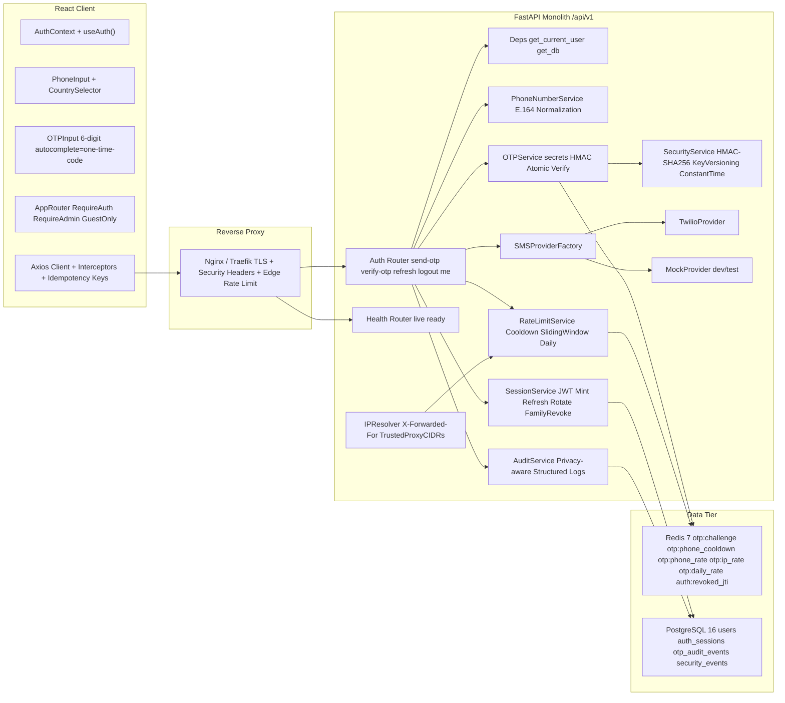
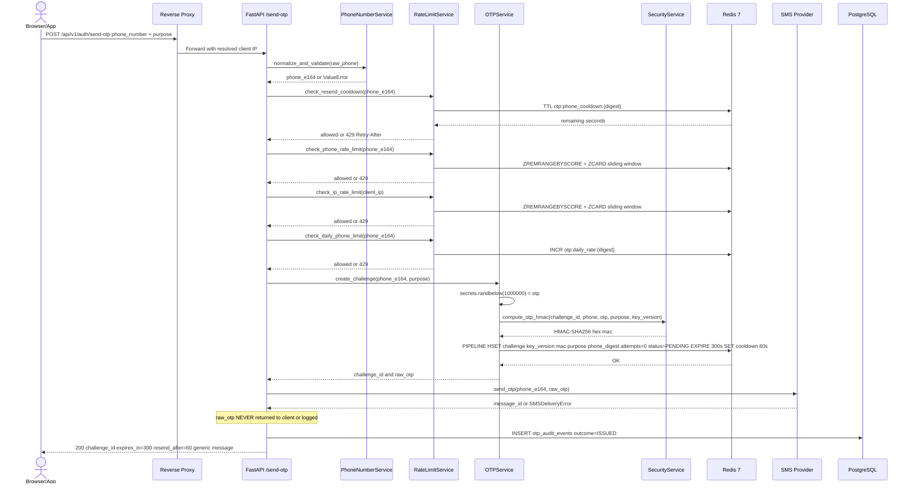
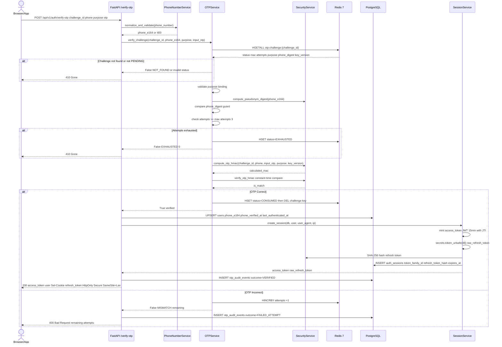
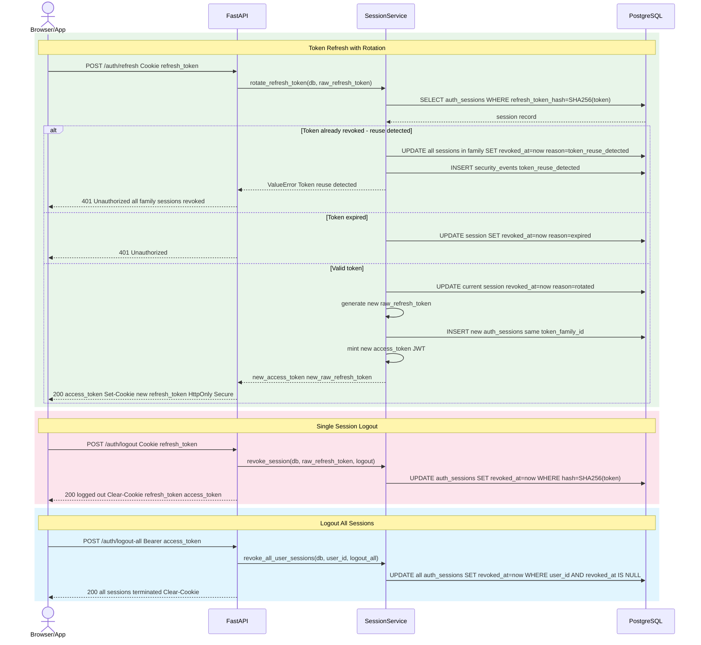
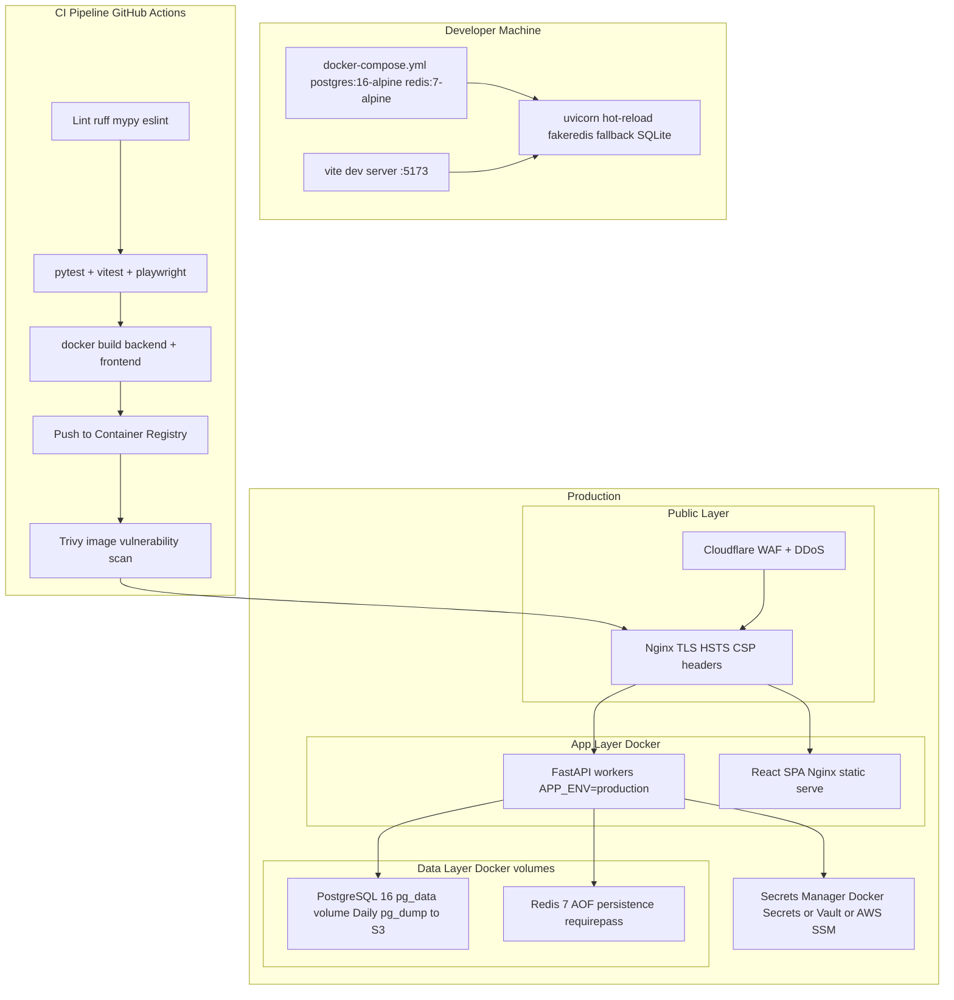

# High-Level Design (HLD)
## Jai Bhavani Pearls & Beads — Secure Mobile Phone OTP Authentication System

> **Version:** 1.0  
> **Date:** 2026-10-30  
> **Status:** Architecture Baseline — Phase 2 Complete

---

## 1. Project Overview and Objectives

### Context
Jai Bhavani Pearls & Beads is an e-commerce platform selling pearls and beads. The authentication system secures both the **customer storefront** (browse, cart, checkout, orders) and the **admin panel** (products, orders, inventory, reports, audit logs).

### Problem Statement
Password-based authentication has high friction for mobile users and is subject to credential-stuffing attacks. OTP-based phone authentication provides a phishing-resistant, passwordless flow that is familiar to the Indian e-commerce audience.

### Objectives
| # | Objective |
|---|-----------|
| 1 | Issue a cryptographically secure 6-digit OTP via SMS and verify it within a bounded time window |
| 2 | Prevent brute-force, replay, and race-condition attacks at the protocol level |
| 3 | Enforce per-phone, per-IP, and global SMS rate limits to prevent toll fraud |
| 4 | Issue short-lived JWT access tokens and rotating opaque refresh tokens |
| 5 | Detect and immediately revoke compromised refresh-token families |
| 6 | Never store OTPs, raw refresh tokens, or HMAC keys in cleartext in any persistent store |
| 7 | Provide a provider-agnostic SMS adapter (Twilio default; MSG91 / AWS SNS / 2Factor extensible) |
| 8 | Support role-based authorization: `customer`, `admin`, `support`, `inventory` |
| 9 | Meet accessibility (WCAG 2.1 AA) and mobile-first UX requirements |
| 10 | Deploy as a containerized modular monolith with PostgreSQL + Redis; extract services on demand |

---

## 2. Functional and Non-Functional Requirements

### 2.1 Functional Requirements

| ID | Requirement |
|----|-------------|
| FR-01 | Accept a phone number and normalize it to E.164 using the Google `phonenumbers` library |
| FR-02 | Generate a 6-digit cryptographically secure OTP via `secrets.randbelow` |
| FR-03 | Store an HMAC-SHA256 of the challenge context (not the raw OTP) in Redis with TTL |
| FR-04 | Dispatch the OTP via a pluggable SMS provider (Twilio default; mock for dev/test) |
| FR-05 | Return an opaque `challenge_id`, expiry, and resend cooldown to the client |
| FR-06 | Accept `challenge_id`, phone, purpose, and OTP for verification |
| FR-07 | Atomically validate the challenge, consuming the attempt count and invalidating on success |
| FR-08 | Create or update the user record in PostgreSQL on successful verification |
| FR-09 | Issue a short-lived JWT access token (15 min) and an opaque refresh token (14 days) |
| FR-10 | Rotate the refresh token on every `/auth/refresh` call; detect and reject reuse |
| FR-11 | Revoke a single session (`/auth/logout`) or all sessions (`/auth/logout-all`) |
| FR-12 | Serve the authenticated user profile via `GET /auth/me` |
| FR-13 | Expose liveness (`/health/live`) and readiness (`/health/ready`) health endpoints |
| FR-14 | Record privacy-compliant audit events for every OTP issuance, verification, and session event |

### 2.2 Non-Functional Requirements

| Category | Requirement |
|----------|-------------|
| **Security** | OTPs never logged or returned in production API responses; HMAC key versioning; constant-time comparison; fail-closed on Redis/DB unavailability |
| **Performance** | OTP send p95 < 500 ms (excluding SMS gateway); verify p95 < 200 ms |
| **Availability** | 99.5% monthly uptime target; graceful SMS provider failover |
| **Scalability** | Stateless FastAPI workers behind a load balancer; Redis cluster-capable key design |
| **Observability** | Structured JSON logs; Prometheus metrics; distributed tracing hooks |
| **Compliance** | No raw phone numbers in logs (keyed HMAC pseudonyms); refresh tokens stored as SHA-256 hashes only |
| **Maintainability** | Modular monolith with clean service boundaries; Alembic migrations; documented dependency versions |
| **Testability** | Isolated fakeredis + SQLite harness; mock SMS provider; concurrency and security test suites |
| **Deployment** | Docker + Docker Compose; CI/CD pipeline; secrets manager integration in production |

---

## 3. System Context and Trust Boundaries



### Trust Boundary Summary

| Boundary | Protocol | Controls |
|----------|----------|----------|
| Browser to CDN/Proxy | HTTPS TLS 1.3 | HSTS; certificate management |
| Proxy to FastAPI | HTTP (private VLAN) | IP allowlist; no public port |
| FastAPI to Redis | TCP (private VLAN) | `requirepass`; private network only |
| FastAPI to PostgreSQL | TCP (private VLAN) | Strong credentials; SSL in production |
| FastAPI to Twilio | HTTPS outbound | API key from secrets manager; never in code |
| Twilio Webhooks inbound | HTTPS | Twilio signature header validation |

---

## 4. Architecture Diagram — Modular Monolith



---

## 5. Authentication Request Sequence (Send OTP)



---

## 6. OTP Verification Sequence



> **Recovery Note:** Redis and PostgreSQL are **not** one atomic transaction. If Redis consumes the challenge but PostgreSQL fails, the challenge is permanently consumed — the user must request a new OTP. This is the correct fail-closed behaviour; no security regression occurs.

---

## 7. Session Refresh and Logout Sequence



---

## 8. Component Responsibility Matrix

| Component | Responsibilities | Failure Mode |
|-----------|-----------------|-------------|
| **React Auth Client** | Phone input, country selector, 6-digit OTP entry, resend countdown, session restoration via `/auth/me`, protected routes (`RequireAuth`, `RequireAdmin`), logout | Display error; on 401 redirect to `/login` |
| **Reverse Proxy (Nginx)** | TLS termination, HSTS/CSP/X-Frame-Options headers, edge rate limiting, `X-Forwarded-For` injection | Serve 502/503 from upstream failure |
| **FastAPI Application** | Request routing, schema validation, middleware orchestration, dependency injection, error handling | Return structured JSON error |
| **PhoneNumberService** | E.164 normalization and validation using `phonenumbers` | `ValueError` → 400 Bad Request |
| **OTPService** | OTP generation (`secrets`), HMAC challenge creation, atomic challenge verification, single-use enforcement | Redis error → 503 Service Unavailable |
| **RateLimitService** | Resend cooldown (Redis TTL), per-phone sliding window (Redis ZSET), per-IP sliding window (Redis ZSET), daily phone limit (Redis INCR) | On Redis failure → fail closed (block with 503) |
| **SecurityService** | HMAC-SHA256 computation, key versioning, constant-time comparison, keyed pseudonym digest, refresh token SHA-256 hashing | Key missing → fallback to first available key |
| **SMS Provider Adapter** | Abstract provider interface (`BaseSMSProvider`); Twilio and Mock implementations; structured error classification | `SMSDeliveryError(is_retryable)` → 503 |
| **SessionService** | JWT minting with JTI+exp+iss+sub+role claims; opaque refresh token generation; token rotation with reuse detection; single and bulk revocation | DB error → 500 with rollback |
| **PostgreSQL Layer** | Durable storage: users, auth_sessions, otp_audit_events, security_events | `OperationalError` → 500 |
| **Redis Layer** | Ephemeral: OTP challenges (TTL 300s), cooldowns (60s), rate limit windows, daily counters, revoked JTI list | `ConnectionError` → raise; fakeredis fallback in dev |
| **Audit Layer** | Privacy-compliant structured events; phone_digest (never plaintext); no OTP/token/HMAC in logs | Best-effort; auth proceeds even if audit write fails |
| **IPResolver Middleware** | Extract verified client IP from `X-Forwarded-For`, respecting only trusted proxy CIDRs | Fallback to `request.client.host` |

---

## 9. Deployment Architecture



### Environment Strategy

| Environment | Database | Redis | SMS Provider | Secret Source |
|-------------|----------|-------|-------------|--------------|
| Development | SQLite (default) | fakeredis (auto-fallback) | mock | `.env` file |
| Testing (CI) | SQLite (isolated) | fakeredis | mock | pytest fixtures |
| Staging | PostgreSQL (Docker) | Redis (Docker) | Twilio test credentials | CI secrets |
| Production | PostgreSQL (managed) | Redis (managed) | Twilio live | Secrets Manager |

---

## 10. Failure-Handling Strategy

| Failure Scenario | Detection | Handling | User Impact |
|-----------------|-----------|----------|------------|
| **SMS delivery failure** | `SMSDeliveryError` | Log; return 503; do NOT auto-retry (toll fraud risk) | "Unable to send SMS. Please retry." |
| **Provider timeout** | Timeout exception | Classify retryable; return 503 | Same as above |
| **Redis unavailable (OTP send)** | `ConnectionError` on pipeline | Return 503; no challenge issued | "Service temporarily unavailable." |
| **Redis unavailable (rate limit)** | `ConnectionError` | Fail closed: block with 503 | Request blocked conservatively |
| **Redis unavailable (verify)** | `ConnectionError` on HGETALL | Return 503 | "Verification unavailable." |
| **PostgreSQL unavailable** | `OperationalError` | Return 500; rollback | "A system error occurred." |
| **Redis OK, PostgreSQL fails (verify)** | DB error after challenge consumed | Challenge consumed (not replayable); user must request new OTP | "System error. Request a new code." |
| **Duplicate send-otp** | Cooldown key present | Return 429 + `Retry-After` | UI shows countdown |
| **Duplicate verify** | Challenge status = `CONSUMED` | Return 410 Gone | "Code already used. Request a new one." |
| **Concurrent verification** | Atomic HINCRBY; first consumer wins | At most one success per challenge | Non-winning request fails as MISMATCH |
| **Session refresh race** | Unique constraint on `refresh_token_hash` | DB serializes; first rotation wins | Second caller gets 401 |
| **Expired challenge** | Redis TTL expired; key missing | `NOT_FOUND` → 410 Gone | "Code expired. Request a new one." |
| **Token reuse detected** | `revoked_at IS NOT NULL` | Revoke entire token family; log security event | 401 + "All sessions revoked. Log in again." |

---

## 11. Security Architecture

### 11.1 OTP Cryptography

| Property | Implementation |
|----------|---------------|
| Generation | `secrets.randbelow(1_000_000)` — zero-padded 6-digit string |
| Storage | `HMAC-SHA256(key, challenge_id + ":" + phone_e164 + ":" + otp + ":" + purpose)` |
| Key management | Versioned JSON dict `{v1: hex_secret, v2: hex_secret}`; `OTP_HMAC_CURRENT_KEY_VERSION` controls signing |
| Comparison | `hmac.compare_digest()` — guaranteed constant-time |
| Expiry | Redis TTL (300 s) as primary control; application validates independently |
| Single-use | Challenge key deleted immediately on successful verification |
| Attempt limit | Maximum 3 attempts; `HINCRBY` increment; status set to `EXHAUSTED` |

### 11.2 Session Security

| Property | Implementation |
|----------|---------------|
| Access token | HS256 JWT; claims: `sub`, `role`, `jti`, `iat`, `exp` (15 min), `iss` |
| Refresh token | `secrets.token_urlsafe(48)` (384-bit entropy); stored as `SHA-256` hash only in DB |
| Token rotation | Old token revoked on every `/auth/refresh` call |
| Reuse detection | Presenting a revoked token revokes entire `token_family_id` |
| Cookie flags | `HttpOnly=True`, `Secure=True` (production), `SameSite=Lax`, scoped path |
| CSRF protection | `SameSite=Lax` + explicit CORS origin allowlist; no wildcard `*` with credentials |
| Logout | Immediate `revoked_at` in DB; cookies cleared |

### 11.3 Rate Limiting Layers

```
Layer 1 (Edge):  Cloudflare / Nginx — IP-level, request-level limits
Layer 2 (App):   Per-phone resend cooldown — Redis TTL, 60 seconds
Layer 3 (App):   Per-phone sliding window — Redis ZSET, 3 per 15 minutes
Layer 4 (App):   Per-IP sliding window — Redis ZSET, 10 per 15 minutes
Layer 5 (App):   Per-phone daily limit — Redis INCR, 10 per 24 hours
Layer 6 (Provider): Twilio spending cap + geographic allowlist
```

### 11.4 Privacy and Audit Controls

- Phone numbers are **never** stored in logs or Redis keys in plaintext
- All log entries and Redis keys use `HMAC-SHA256(server_secret, phone_e164)[:32]` pseudonyms
- OTPs, HMAC values, raw refresh tokens, and provider credentials are **never** logged
- `otp_audit_events`: `challenge_id`, `phone_digest`, `operation`, `outcome`, `attempt_count`
- `security_events`: `event_type`, `user_id`, `phone_digest`, `ip_address_hash`, `details` (sanitized JSON)

### 11.5 Input Validation

| Field | Validation |
|-------|------------|
| `phone_number` | `phonenumbers.parse()` + `is_valid_number()` → E.164 |
| `purpose` | Enum: `login`, `register`, `verify_phone` |
| `otp` | `len==6`, `isdigit()` enforced by Pydantic validator |
| `challenge_id` | UUID4 format from server |
| `refresh_token` | Opaque; looked up by SHA-256 hash only |

---

## 12. Scalability and Cost Considerations

### Horizontal Scaling Path (Modular Monolith to Services)

| Current (Monolith) | Extraction Trigger | Extracted Service |
|--------------------|-------------------|-------------------|
| RateLimitService in-process | >10k req/min or multi-region | Standalone Rate Limit Service (Redis-backed) |
| SessionService in-process | >100k concurrent sessions or SSO needs | Auth Token Service |
| SMSProvider adapter | Multiple provider SLAs to manage | SMS Gateway Microservice with queue |
| AuditService in-process | SIEM/compliance integration | Audit Event Stream (Kafka/Kinesis) |

### Cost Controls

| Item | Control |
|------|---------|
| SMS costs | Per-phone daily limit (10/day); per-phone 15-min window (3); Twilio spending cap |
| Redis memory | TTL on all keys; no unbounded growth |
| PostgreSQL storage | `otp_audit_events` purge job (90-day retention); session cleanup job |
| Compute | Stateless FastAPI workers; horizontal scaling |

---

## 13. Architecture Decisions and Trade-offs

| Decision | Chosen | Alternatives | Rationale |
|----------|--------|-------------|-----------|
| **Monolith vs Microservices** | Modular monolith | Microservices | Lower operational complexity; service boundaries already clean for future extraction |
| **OTP storage** | HMAC-SHA256 in Redis with TTL | Plaintext; bcrypt | Faster than bcrypt; binds OTP to challenge context; prevents offline dictionary attack on Redis dump |
| **Redis+PG atomicity** | Accept partial failure (fail closed) | 2-phase commit | True XA adds complexity and latency; fail-closed is secure; user requests new OTP |
| **Refresh token rotation** | Rotate on every `/auth/refresh` | Long-lived static token | Forward secrecy; stolen token self-reveals on reuse |
| **SameSite=Lax vs Strict** | Lax | Strict | Strict breaks top-level navigation; Lax protects CSRF while permitting GET flows |
| **SQLite in dev/test** | SQLite + fakeredis | PostgreSQL/Redis always | Eliminates Docker dependency for development and CI unit tests |
| **HMAC key versioning** | JSON dict `{v1, v2}` | Single key | Enables zero-downtime key rotation while old challenges still in-flight |
| **Phone pseudonyms** | `HMAC(server_key, phone)[:32]` | No logging; plaintext | Enables abuse correlation without storing PII in logs |
| **Attempt atomicity** | HGETALL + HINCRBY (non-atomic path) | Full Lua script | TOCTOU risk is very low at current scale; Lua upgrade documented in LLD |

---

## Appendix A: Dependency Versions

### Backend

| Package | Version | Purpose |
|---------|---------|---------|
| `fastapi` | 0.141.x | API framework |
| `uvicorn[standard]` | 0.30.x | ASGI server |
| `pydantic` | 2.13.x | Schema validation |
| `pydantic-settings` | 2.x | Settings from environment |
| `sqlalchemy` | 2.0.x | ORM |
| `alembic` | 1.13.x | Database migrations |
| `psycopg[binary]` | 3.x | PostgreSQL driver |
| `redis` | 5.x | Redis client |
| `fakeredis` | 2.x | In-memory Redis for tests |
| `phonenumbers` | 8.13.x | Phone validation/normalization |
| `PyJWT` | 2.9.x | JWT encode/decode |
| `twilio` | 9.x | Twilio SMS SDK |
| `pytest` | 9.x | Test framework |
| `httpx` | 0.27.x | HTTP client for tests |

### Frontend

| Package | Version | Purpose |
|---------|---------|---------|
| `react` | 18.3.x | UI framework |
| `react-router-dom` | 6.26.x | Client-side routing |
| `typescript` | 5.5.x | Type safety |
| `vite` | 5.4.x | Build tool |
| `axios` | 1.7.x | HTTP client with interceptors |
| `@tanstack/react-query` | 5.59.x | Server state management |
| `react-hook-form` | 7.53.x | Form handling |
| `zod` | 3.23.x | Schema validation |
| `tailwindcss` | 3.4.x | Utility CSS |
| `vitest` | 2.1.x | Unit and component tests |
| `@playwright/test` | 1.48.x | End-to-end tests |

---

*Next: [LLD.md](./LLD.md) — Low-Level Design, [DATABASE.md](./DATABASE.md) — Schema and Migrations, [TEST_PLAN.md](./TEST_PLAN.md) — Test Strategy*
